<!-- GINO ODAR / AI SYSTEMS & INTEGRATION ENGINEERING -->
<!-- Featured projects are regenerated from config/projects.json. -->

  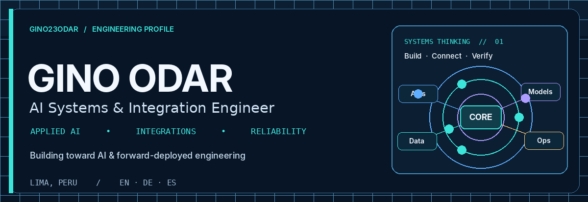

<!-- GitHub-compatible two-image banner: the ASCII GIF is animated; the terminal text panel is a separate static PNG. -->
<table align="center">
  <tr>
    <td width="34%" align="center" valign="middle">
      
    </td>
    <td width="66%" align="center" valign="middle">
      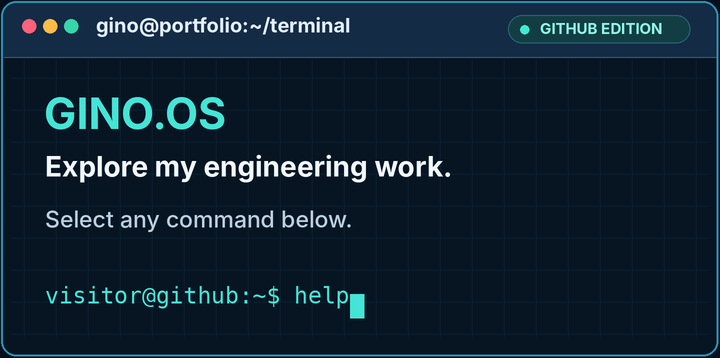
    </td>
  </tr>
</table>

I'm **Gino**, an **AI Systems & Integration Engineer** based in Lima, Peru, with a foundation in **backend development, API integrations, quality engineering and production troubleshooting**. I work across application layers to understand why systems behave the way they do — from services and data flows to user-facing behavior and automated tests.

My focus is moving toward **applied AI and forward-deployed engineering**: connecting models to real systems, designing dependable tool integrations, evaluating outcomes and shipping software that solves an actual problem. My public work includes a collaborative LLM hackathon project, a full-stack prototype with pluggable providers, and tested Python engineering projects.

**What I bring:** backend and integration experience, systematic debugging, Playwright-based QA, and an engineering mindset that treats observability, permissions and evaluation as part of the product — not an afterthought.

### Professional engineering experience

My professional work has spanned **backend development, integrations, technical investigation and software quality** across a production software environment:

- **Backend & integration engineering:** Worked with Java / Spring Boot services, REST APIs, reporting and attribution workflows, and third-party advertising integrations. Investigated issues that cross service, database and frontend boundaries.
- **QA automation & reliability:** Worked with **Playwright** for UI and end-to-end testing, reproducible staging scenarios, regression coverage, and validation of complex reporting interactions. Investigated flaky tests and defects that required understanding the underlying service behavior.
- **Cross-layer debugging:** Analyzed API responses, SQL records, application logs and unexpected UI states to isolate root causes and verify fixes, including test-data setup when reproduction required controlled conditions.
- **Monitoring & delivery:** Used **New Relic** and **Amazon CloudWatch** in issue investigation; worked in environments using **Jenkins**, **Semaphore CI**, Docker, Linux, OpenSearch and ClickHouse.
- **Collaboration:** Worked across implementation, QA and technical troubleshooting, translating observed failures into clear reproduction steps, technical findings and verification work.

Most professional code is held in private repositories. The projects below are **separate public work**, not employer source code or demonstrations of proprietary architectures.

### Selected public work

Cards are generated from [config/projects.json](./config/projects.json). Edit the featured list and run the generator to swap projects or rearrange them.

<!-- FEATURED_PROJECTS:START -->

<table>
<tr>
<td width="50%" valign="top">
  <a href="https://github.com/gino23odar/LlamaImpact-hackathon-streamlit">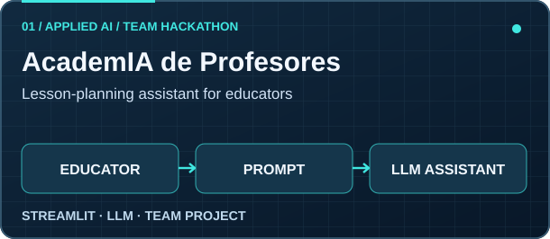</a>
   <b><a href="https://github.com/gino23odar/LlamaImpact-hackathon-streamlit">AcademIA de Profesores</a></b> 
  Collaborative Llama Impact hackathon project: a Streamlit-based assistant intended to help educators prepare lesson plans. Team effort.
</td>
<td width="50%" valign="top">
  <a href="https://github.com/gino23odar/gen-vault">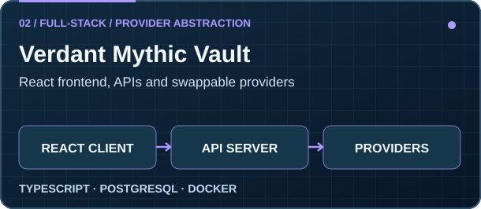</a>
   <b><a href="https://github.com/gino23odar/gen-vault">Verdant Mythic Vault</a></b> 
  Full-stack React/TypeScript + Express/PostgreSQL prototype with provider abstractions and mock-service mode. Real model-provider integrations are future work.
</td>
</tr>
<tr>
<td width="50%" valign="top">
  <a href="https://github.com/gino23odar/queue-management-simulation">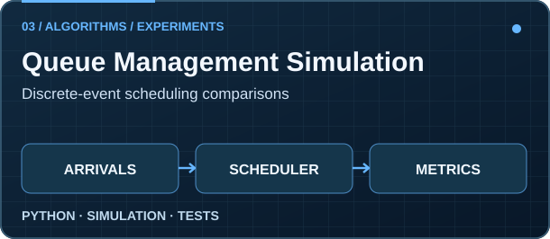</a>
   <b><a href="https://github.com/gino23odar/queue-management-simulation">Queue Management Simulation</a></b> 
  Python discrete-event simulation comparing FCFS, shortest-processing-time and priority scheduling under controlled workloads, with automated tests.
</td>
<td width="50%" valign="top">
  <a href="https://github.com/gino23odar/dlmdspwp01-written-assignment">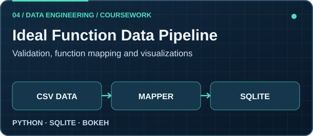</a>
   <b><a href="https://github.com/gino23odar/dlmdspwp01-written-assignment">Ideal Function Data Pipeline</a></b> 
  Python coursework project combining CSV validation, ideal-function mapping, SQLite persistence, automated tests and Bokeh visualizations.
</td>
</tr>
</table>

<!-- FEATURED_PROJECTS:END -->

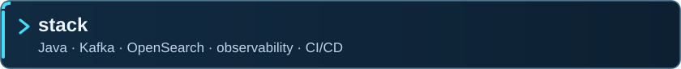

### Engineering foundation

  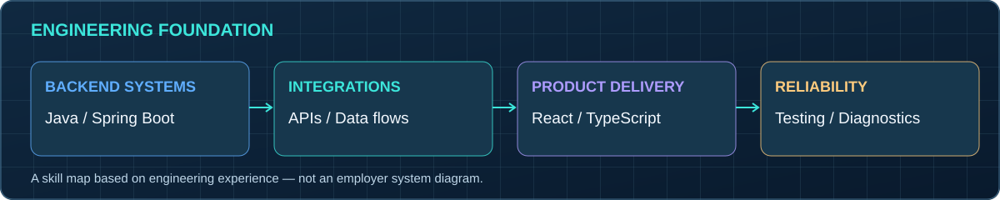

| Area | Technologies & practices |
| :-- | :-- |
| **Backend & APIs** | Java, Spring Boot, Node.js, Express, Python, REST APIs, Kafka |
| **Data, search & analytics** | PostgreSQL, MySQL, SQLite, **OpenSearch, ClickHouse**, SQL |
| **CI/CD & infrastructure** | **Jenkins, Semaphore CI**, GitHub Actions, Docker, Linux, Bash, AWS tooling |
| **Observability** | **New Relic, Amazon CloudWatch**, logs, tracing and production diagnostics |
| **QA & testing** | **Playwright**, Selenium, JUnit, Mockito, end-to-end tests, regression testing, debugging flaky tests |
| **Frontend & mobile** | TypeScript, JavaScript, React, Next.js, React Native |

  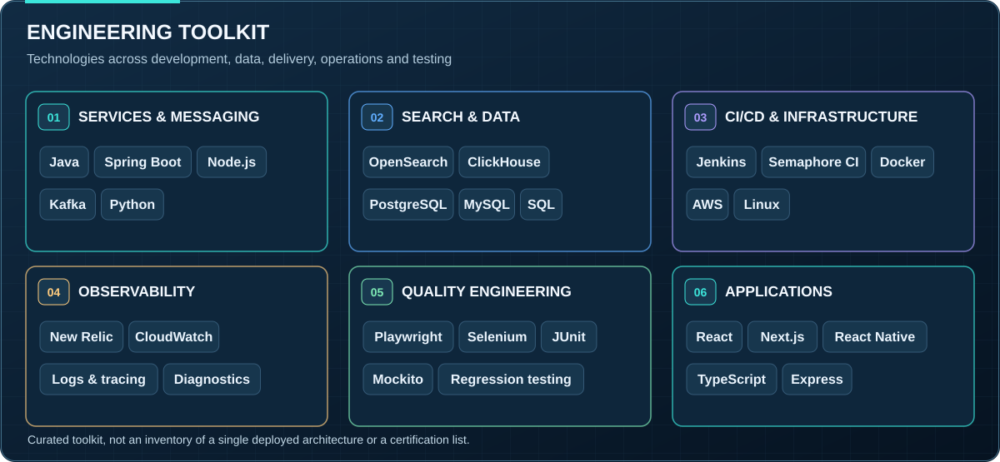

### AI engineering toolkit

  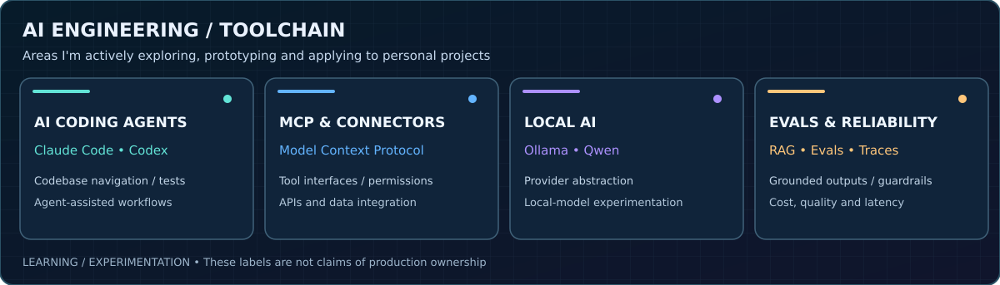

My focus is on **applied AI systems**, especially where AI needs to interact with real APIs, data and production tooling. I separate work I've actually built from technologies I'm studying or experimenting with:

| Area | Tools, practices & status |
| :-- | :-- |
| **Hands-on AI work** | Collaborative **LLM + Streamlit hackathon project**; local LLM workflows with **Ollama / Qwen**; provider-abstraction prototype with mock implementations |
| **AI developer tooling — exploring** | **Claude Code**, **OpenAI Codex**, **Model Context Protocol (MCP)** clients/servers and AI-assisted development workflows |
| **Agent engineering — focus** | Tool/function calling, structured outputs, orchestration patterns, human-in-the-loop approval, durable workflows |
| **Retrieval & context — focus** | Retrieval-augmented generation (RAG), hybrid search, context engineering, source-grounded responses, authorization-aware retrieval |
| **Quality & operations — focus** | LLM evaluations, regression datasets, prompt-injection defenses, traceability, latency/cost monitoring, operational guardrails |

**The principle:** It's not enough for an AI demo to answer questions. It should connect to the right information, respect access boundaries, handle failures and provide evidence that its outputs are useful.

Tools labeled "exploring" or "focus" are areas of active interest and development, **not claims of professional production deployment or certification**.

### What I'm building toward

- **GINO.OS GitHub Edition:** Clickable portfolio commands and a public Issue-based Q&A bot backed by verified career/project records. A richer GitHub Pages terminal remains a possible future extension.
- **Enterprise AI integrations:** Secure connector patterns, MCP interoperability, authorization-aware tools, orchestration and evaluation.
- **Forward-deployed engineering:** Working directly from a real business problem through integrations, deployment, QA and measurable outcomes.

I'm particularly interested in roles at the intersection of **AI engineering, platform integration and software reliability**.

### Applied AI systems

  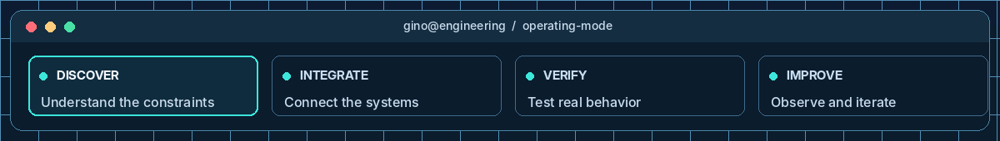
    
  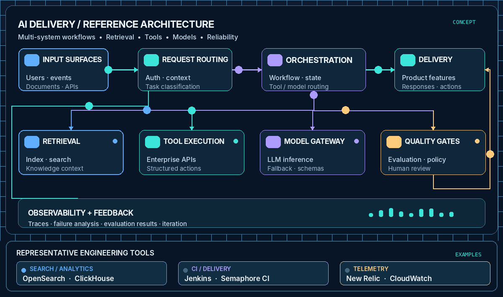

I'm interested in the **full lifecycle of an AI-enabled application**: understanding constraints, integrating data and tools, controlling model behavior, writing meaningful evaluations, monitoring failures and improving the experience after launch.

*Reference architecture for discussion and exploration, not a claim that I've deployed this entire stack in one customer system.*

### Connect

  <b>Have an interesting systems or AI integration problem?</b>  
  <a href="https://www.ginoodar.com">Portfolio</a> &nbsp;·&nbsp;
  <a href="https://www.linkedin.com/in/gino-odar/">LinkedIn</a> &nbsp;·&nbsp;
  <a href="https://github.com/gino23odar?tab=repositories">GitHub Projects</a>
    
  Lima, Peru &nbsp;·&nbsp; English / German / Spanish

### Ask GINO.OS

**Ask a question about my professional background or public projects.**

[**Open the GINO.OS question form**](https://github.com/gino23odar/gino23odar/issues/new?template=ask-gino-os.yml)

The form opens a **public GitHub Issue**; the bot replies there using the verified information in [`config/profile_knowledge.json`](./config/profile_knowledge.json) and [`config/projects.json`](./config/projects.json), once GitHub Issues and Actions are enabled. You need a GitHub account to submit a question, and questions and answers are public.

<b>⌁ $ demo</b> — Example questions & verified answers

**Q:** What experience does Gino have with Playwright?

**A:** Playwright-based UI and end-to-end test automation, staging investigations, regression testing, and debugging issues involving APIs, databases and user interfaces. [Engineering experience](#gino-experience)

**Q:** Has Gino deployed an enterprise AI agent platform?

**A:** No such deployment is claimed here. The profile documents real backend/integration experience and describes AI orchestration and MCP as current development areas. [AI engineering toolkit](#gino-ai)

<b>⌁ $ how-ask-works</b> — GitHub-native Q&A

1. Click **Ask GINO.OS**, sign in to GitHub if necessary, and submit a question in the Issue form.
2. A GitHub Action reads public information from [`config/profile_knowledge.json`](./config/profile_knowledge.json) and the featured entries in [`config/projects.json`](./config/projects.json).
3. The bot posts its response and relevant links **in your Issue thread**. A deterministic, no-key mode works by default; optional AI phrasing can be enabled later.
4. Follow up in the same Issue with `/ask your question` (up to three follow-ups per thread).

**Privacy:** Questions and replies are publicly visible on GitHub. Do not submit confidential information. This is not a text-input widget embedded inside the README.

[Command reference](./docs/terminal/help.md) · [Browse repositories](https://github.com/gino23odar?tab=repositories)

GitHub may still show a small native disclosure triangle. Multiple panels can remain open; the `ask` panel links to a public GitHub Issue form.

  <picture>
    <source media="(prefers-color-scheme: dark)" srcset="https://readme-typing-svg.demolab.com/?font=Fira+Code&amp;weight=600&amp;size=24&amp;duration=3000&amp;pause=1100&amp;color=3BF74E&amp;center=false&amp;vCenter=true&amp;width=990&amp;height=62&amp;repeat=true&amp;lines=Building+reliable+AI+integrations.;Backend+systems%2C+APIs+and+Playwright+QA.;Kafka%2C+OpenSearch+and+observability.;Exploring+MCP%2C+Claude+Code+and+Codex.;Select+a+command+below+to+explore." />
    <source media="(prefers-color-scheme: light)" srcset="https://readme-typing-svg.demolab.com/?font=Fira+Code&amp;weight=600&amp;size=24&amp;duration=3000&amp;pause=1100&amp;color=136C29&amp;center=false&amp;vCenter=true&amp;width=990&amp;height=62&amp;repeat=true&amp;lines=Building+reliable+AI+integrations.;Backend+systems%2C+APIs+and+Playwright+QA.;Kafka%2C+OpenSearch+and+observability.;Exploring+MCP%2C+Claude+Code+and+Codex.;Select+a+command+below+to+explore." />
    
  </picture>
   
  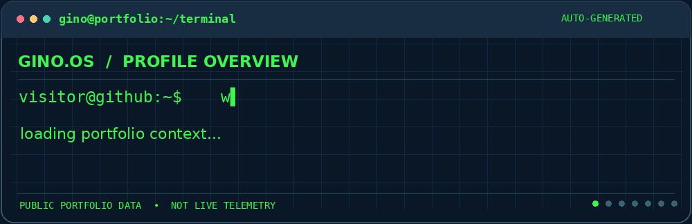

---

**About this interface:** GitHub renders the panels directly. You cannot type into the README; open **ask** to send a question through GitHub Issues. GINO.OS bot replies in the Issue thread after the workflow executes. Only public, owner-reviewed portfolio facts are used, and model-powered phrasing is optional.   
<a href="https://www.ginoodar.com"><b>Portfolio</b></a> &nbsp;·&nbsp;
<a href="https://www.linkedin.com/in/gino-odar/"><b>LinkedIn</b></a> &nbsp;·&nbsp;
<a href="https://github.com/gino23odar?tab=repositories"><b>Repositories</b></a>

